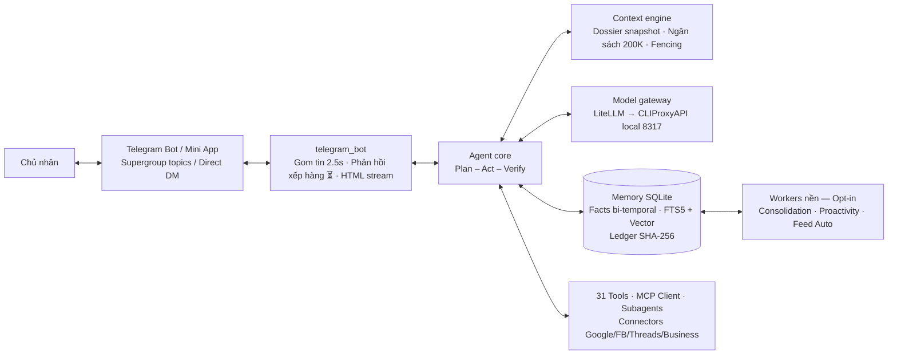

<p align="center">
  
</p>

<h1 align="center">Mulon</h1>

<p align="center">
  <strong>Trợ lý AI cá nhân chạy trong Telegram — nhớ lâu, làm việc thật, tự học từ mỗi lần bị sửa.</strong>
</p>

<p align="center">
  
  
  
  
  
  
</p>

Mulon là một personal AI agent hoàn chỉnh, viết từ đầu theo hướng
**harness-first**: cảm giác "dùng sướng" do khung vận hành bảo đảm —
ngữ cảnh tinh tuyển, vòng lặp có kế hoạch và kiểm chứng, ký ức có
cấu trúc — chứ không phụ thuộc vào độ mạnh của model. Ba ràng buộc
cứng của thiết kế:

- **Telegram-only.** Một supergroup riêng tư bật forum là toàn bộ
  giao diện; mỗi topic là một "tab". Từ 1.2.0 có thêm Mini App
  (bảng điều khiển chạy trong Telegram) cho cấu hình, duyệt việc và
  quản lý hệ sinh thái — tuyệt đối không mở kênh phụ ngoài Telegram.
- **Proxy-only.** Model CHỈ được gọi qua một proxy local tương thích
  OpenAI (mặc định `http://127.0.0.1:8317/v1`, tích hợp sẵn
  **CLIProxyAPI** quản lý tiến trình và định tuyến model). Không dùng
  API đám mây trực tiếp, không khóa cứng vào nhà cung cấp nào.
- **Opt-in tuyệt đối.** Mọi vòng lặp nền (lịch hẹn, consolidation,
  proactivity) mặc định **tắt**; chỉ chạy khi chủ nhân bật đích danh.
  Ngoại lệ đã được chủ nhân duyệt đích danh: Feed chủ động tự đăng
  theo lịch, tự động đồng bộ mã nguồn qua `scripts/auto_watch.py`, và
  kiểm tra cập nhật dữ kiện catalog của Chợ MCP (không bao giờ tự cài).

> Tài liệu thiết kế đầy đủ: [`docs/thiet-ke-ky-thuat-muse-clone.md`](docs/thiet-ke-ky-thuat-muse-clone.md) ·
> Kiến trúc module: [`ARCHITECTURE.md`](ARCHITECTURE.md) ·
> Sổ tay kỹ thuật & chống hardcode: [`docs/technical-reference.md`](docs/technical-reference.md) ·
> Bản đồ Mini App chuẩn: [`docs/sitemap-miniapp-v17.md`](docs/sitemap-miniapp-v17.md)

## Mục lục

- [Tính năng chính](#tính-năng-chính)
- [Kiến trúc hệ thống](#kiến-trúc-hệ-thống)
- [Bắt đầu nhanh (macOS / Windows / Linux)](#bắt-đầu-nhanh)
- [Cấu hình hệ thống](#cấu-hình-hệ-thống)
- [Lệnh Telegram](#lệnh-telegram)
- [Bảng điều khiển Mini App](#bảng-điều-khiển-mini-app)
- [Hệ thống Connectors tích hợp sẵn](#hệ-thống-connectors-tích-hợp-sẵn)
- [Công cụ dòng lệnh](#công-cụ-dòng-lệnh)
- [Kiểm thử & Cổng chất lượng](#kiểm-thử--cổng-chất-lượng)
- [Cấu trúc thư mục](#cấu-trúc-thư-mục)
- [Giấy phép](#giấy-phép)

---

## Tính năng chính

**Vòng lặp làm việc có kiểm chứng.** Mọi yêu cầu đều chạy qua
plan → act → verify: kế hoạch lưu vào DB, các tool độc lập chạy
song song, một bước verify độc lập đối chiếu kết quả trước khi báo
xong; fail thì retry kèm chẩn đoán. Agent bị cấm nói "đã xong" khi
chưa kiểm chứng.

**Ký ức sống, truy được nguồn.** Fact lưu **bi-temporal** (bản cũ
bị thay thế chứ không xóa), recall **hybrid 70% vector / 30% BM25**
(embedding FastEmbed bge-m3 chạy local, degrade sạch về BM25 khi thiếu),
đánh chỉ mục lúc ghi nên truy vấn không cần LLM rerank. Consolidation
worker chắt lọc fact từ hội thoại; mọi thay đổi ký ức vào **sổ cái
append-only có SHA-256**, rollback được.

**Học từ correction theo vòng kín.** Khi chủ nhân sửa, hệ thống
phân loại lỗi theo taxonomy 5 loại, rút thành bài học có cấu trúc
và nạp vào ngữ cảnh các lượt sau. Correction nghiêm trọng tự sinh
test case vào bộ eval — lỗi đã sửa phải không bao giờ lặp lại.

**Cổng model chính thức CLIProxyAPI & muse2api.** Tích hợp bộ
quản lý tiến trình CLIProxyAPI (`mulon/cliproxy.py`), tự động phát hiện
tài khoản, phân loại model (Gemini, Claude, OpenAI, Codex, Grok, Kimi),
quản lý vòng đời và công tắc cổng ngay trên Mini App. Hỗ trợ nhà cung cấp
`muse2api` với alias LiteLLM chuẩn hóa (`openai/muse/muse-spark`).

**Thương hiệu & Bộ sưu tập Mascot Mulon.** Bộ sưu tập 4 mascot độc bản
trong vũ trụ Mulon (`mulon_v0` Sprite cổ điển 21 frame mặc định,
`mulon_spark`, `mulon_cosmo`, `mulon_zen`). Cho phép người dùng đổi tên
hiển thị của bot và chọn mascot đại diện trực tiếp trong Mini App,
tự động đồng bộ sang bot chat Telegram và lưu bền vững vào KV store.

**Telegram Business Chatbot.** Đăng ký webhook Bot API chính chủ
`business_connection` và `business_message`, tự động trả lời thay nick
cá nhân của chủ khi khách hỏi thông tin/giá sản phẩm (tra cứu catalog
chuẩn xác, cấm bịa giá). Với các yêu cầu nhạy cảm (thương lượng giá, khiếu nại,
đặc biệt là thông tin chuyển khoản/STK), bot KHÔNG bao giờ tự gửi mà soạn
nháp kèm thẻ duyệt chuyển về DM của chủ nhân qua `ApprovalBroker`. Tách biệt
ngữ cảnh khách tuyệt đối, không lộ dữ liệu hay quyền của chủ.

**Hệ thống Connectors tích hợp sẵn.** Cài đặt là có sẵn, dùng token
cá nhân người cài lưu an toàn trong Vault:
- **Google Workspace:** Gmail, Calendar, Drive, Docs, Sheets, Keep.
- **Mạng xã hội cá nhân & Fanpage:** Facebook cá nhân (31 hành động),
  Facebook Fanpage (Meta Graph API), Threads (Graph API chính thức +
  Web session + Browser Bridge Playwright cho DM riêng tư), Zalo, Instagram.
- Mọi nội dung bên ngoài đều được bọc tự động qua `<external_data>`
  chống Prompt Injection. Hành động đọc mặc định `allow`, ghi/xoá mặc định `ask`.

**Trải nghiệm Telegram mượt mà & Không gián đoạn.** Phản hồi xếp hàng tức thì
`⏳` (< 1s) khi bot đang bận, tái sử dụng placeholder cho kết quả cuối
cùng; streaming HTML mượt mà loại bỏ hoàn toàn hiện tượng chớp markdown thô;
dọn sạch các dòng phân cách thô `---` gây rác bài viết.

**Bảng điều khiển Mini App 100% chuyên nghiệp.** Giao diện tuân thủ
tỉ lệ màu nhận diện 60/30/10 với màu tím Mulon `#7C3AED`, chiều cao hàng
tương tác tối thiểu 44px, Bottom Sheet L3 chi tiết từng bước, phân trang
lịch sử và thanh tìm kiếm tự động khi danh sách >= 5 mục. Tích hợp sâu
Telegram WebApp SDK (nút quay lại native, haptic feedback, thêm ra màn hình chính).

**Đợt nâng cấp nền tảng & giao diện 1.7.48 → 1.7.62 (T-39 + T-40).**
Độ tin cậy dữ liệu: vá dứt điểm vòng đời teardown của aiosqlite (tiến
trình test tự thoát sạch sau khi chạy xong) và thêm composite index
cho facts bi-temporal. Bảo mật trình duyệt: Chromium worker có chốt
chặn DNS-rebinding kiểm chứng từng hop redirect trước khi mở trang.
API Mini App trả lỗi thống nhất theo chuẩn **RFC 7807** (Problem
Details, thay đổi cộng thêm — client cũ không gãy). Khởi động không
còn độ trễ embedding: FastEmbed warm-up nền kèm circuit breaker theo
tầng model. Code được module hoá có kỷ luật: lớp trình bày Telegram
tách thành `mulon/telegram_delivery.py`, JS của Mini App gom vào
namespace `window.Mulon` (`Mulon.TG` / `Mulon.API` / `Mulon.State` /
`Mulon.Tabs`). Giao diện Mini App cải tổ đồng bộ trải nghiệm Meta
Muse App theo ADR-003: bộ design token Muse Clean Palette, header
Hero Mascot, thẻ tác vụ **Activity Stream** gom nhóm Hôm nay/Hôm qua
kèm **badge nền tảng** (suy ra từ bảng từ khóa khai báo
`config/platform_keywords.json`, không đoán bừa), bố cục split-view
cho Telegram Desktop (≥ 768px) và theme runtime lavender.

---

## Kiến trúc hệ thống



| Module | Vai trò chính |
|---|---|
| `mulon/gateway.py` | LiteLLM → CLIProxyAPI local: streaming HTML, circuit breaker, đếm token |
| `mulon/cliproxy.py` | Quản lý tiến trình CLIProxyAPI loopback 8317, quét tài khoản, phân loại model |
| `mulon/agent.py` | Vòng lặp plan–act–verify, chống lặp tool/URL, tự nhận thức đường thẳng |
| `mulon/context.py` | Snapshot dossier, ngân sách token, memory flush, bọc `<external_data>` |
| `mulon/memory.py` | SQLite WAL: lưu trữ hội thoại, facts bi-temporal, KV store, sổ cái SHA-256 |
| `mulon/commands.py` | Hệ thống bề mặt lệnh Telegram chuẩn hóa, `/help` phân nhóm, chặn lệnh lạ |
| `mulon/business.py` | Telegram Business Chatbot: tự rep giá catalog, soạn nháp thẻ duyệt STK |
| `mulon/connectors.py` · `social_connectors.py` | Khung connector trung tính, Google Workspace, Facebook, Threads, TikTok |
| `mulon/personal_connectors.py` | Connectors cá nhân hóa: Zalo, Facebook, Threads, Instagram session |
| `mulon/threads_browser_bridge.py` | Browser Bridge Playwright gửi DM & Reaction thật trên Threads/Instagram |
| `mulon/vault.py` | Kho bí mật an toàn (Secure Vault), giải mã ref UUID/nhãn, che mờ trong shell |
| `mulon/webapp_server.py` | Backend Mini App (aiohttp): xác thực HMAC initData, API quản trị toàn diện, lỗi chuẩn RFC 7807 |
| `mulon/telegram_delivery.py` | Lớp trình bày & gửi tin Telegram tách khỏi bot chính (định dạng, placeholder, streaming) |
| `mulon/feed_auto.py` · `websearch.py` | Feed chủ động tự đăng theo lịch, suy nhãn giờ động, tìm kiếm tin tức |

---

## Bắt đầu nhanh

Yêu cầu môi trường: **Python 3.12+** (đã kiểm thử và tương thích tốt trên Python 3.12, 3.13, 3.14).

### 1. Cài đặt trên macOS / Linux

```bash
# Clone mã nguồn
git clone https://github.com/mmmnhat/mulon-v2.git && cd mulon-v2

# Tạo virtualenv và cài đặt gói phụ thuộc
python3 -m venv .venv
source .venv/bin/activate
pip install -r requirements.txt

# Thiết lập cấu hình cơ bản
cp .env.example .env
# Điền TELEGRAM_BOT_TOKEN (từ @BotFather) và ALLOWED_USER_ID (từ @userinfobot) vào .env

# Chạy thử nghiệm cấu hình (không cần token thật)
python -m mulon.main --dry-run

# Khởi động bot chính thức
python -m mulon.main
```

### 2. Cài đặt trên Windows

Mulon hỗ trợ đầy đủ Windows (tự động xử lý múi giờ IANA qua thư viện `tzdata` và quyền hạn tệp Vault trên NTFS):

```powershell
# Clone mã nguồn
git clone https://github.com/mmmnhat/mulon-v2.git
cd mulon-v2

# Tạo và kích hoạt virtualenv
python -m venv .venv
.venv\Scripts\activate

# Cài đặt gói phụ thuộc (bao gồm tzdata cho Windows)
pip install -r requirements.txt

# Thiết lập file cấu hình
copy .env.example .env
# Chỉnh sửa file .env với Notepad hoặc editor tùy chọn

# Chạy kiểm tra và khởi động
python -m mulon.main --dry-run
python -m mulon.main
```

### 3. Tự động hóa cập nhật (`auto_watch`)

Để bot tự động kéo code mới từ nhánh `main` và khởi động lại an toàn sau ~15 giây:

```bash
python scripts/auto_watch.py --enable
```

---

## Cấu hình hệ thống

Tất cả cấu hình được quản lý qua biến môi trường tại `.env` (tham khảo [`.env.example`](.env.example)):

| Biến môi trường | Mặc định | Chức năng |
|---|---|---|
| `PROXY_BASE_URL` | `http://127.0.0.1:8317/v1` | Cổng loopback gọi model qua CLIProxyAPI |
| `MODEL_BRAIN` | `gemini-3.8-flash` | Model tầng não chính (tổng hợp, suy luận) |
| `MODEL_CHEAP` | `gemini-3.8-flash` | Model tầng rẻ (tóm tắt, phân loại nhanh) |
| `MODEL_ESCALATED` | `gemini-3.8-flash` | Model tầng cao khi tác vụ vượt ngưỡng |
| `TELEGRAM_BOT_TOKEN` | — | Token bot được cấp từ @BotFather (bắt buộc) |
| `ALLOWED_USER_ID` | — | Telegram ID của chủ nhân duy nhất (bắt buộc) |
| `BOT_USERNAME` | `Mulon_bot` | Username Telegram của bot |
| `BOT_DISPLAY_NAME` | `Mulon` | Tên hiển thị của bot trong app và chat |
| `BOT_MASCOT` | `mulon_v0` | Mascot đại diện (`mulon_v0`, `mulon_spark`, `mulon_cosmo`, `mulon_zen`) |
| `WEBAPP_PORT` | `8320` | Cổng bind local cho backend Mini App |
| `WEBAPP_URL` | — | URL HTTPS công khai (Cloudflare Tunnel / Reverse Proxy) trỏ về cổng 8320 |
| `INIT_DATA_MAX_AGE_S` | `86400` | Thời hạn hiệu lực phiên Mini App (24 giờ) |
| `TELEGRAM_BUSINESS_ENABLED` | `0` | Bật/tắt tính năng Telegram Business Chatbot (`1` = Bật) |
| `VAULT_PORT` | `8765` | Cổng web nhập bí mật một lần (`0` = tắt) |

---

## Lệnh Telegram

Bề mặt lệnh Telegram được chuẩn hóa toàn diện theo kiến trúc mới (T-26). Mọi lệnh lạ đều bị chặn ngay lập tức mà không tiêu tốn token gọi model:

| Nhóm lệnh | Cú pháp | Diễn giải chức năng |
|---|---|---|
| **Trợ giúp** | `/help [nhóm]` | Xem bảng tra cứu lệnh phân loại theo từng nhóm công việc |
| **Lõi** | `/start` · `/status` · `/new` · `/menu` | Bắt đầu, kiểm tra trạng thái, làm mới phiên, mở Mini App |
| **Quản lý Topic** | `/setup_topics` · `/topics` | Khởi tạo cấu trúc topic-tab trong Supergroup, xem bản đồ |
| **Đoạn chat phụ** | `/chatphu <tên>` · `/chatphu_list` · `/chatphu_dong` · `/chatphu_mo` | Mở và quản lý các luồng chat phụ cô lập lịch sử hội thoại |
| **Lịch & Feed** | `/upcoming` · `/feedbrief` · `/feedsources` | Xem các việc sắp diễn ra (suy nhãn giờ động), chỉnh sửa brief feed |
| **Ý tưởng & Đề xuất** | `/ideas` · `/idea_do <id>` · `/idea_bo <id>` · `/notes` | Quản lý thẻ ý tưởng tự sinh, duyệt đề xuất hành động |
| **Thư viện tài liệu** | `/library` · `/trash_item` · `/restore_item` · `/share_item` | Quản lý tệp sinh ra (Artifacts), phục hồi từ thùng rác |
| **Ký ức & Hồ sơ** | `/memory` · `/forget <chủ đề>` · `/export_memory` · `/import_memory` | Xem ký ức theo nguồn, quên có xác nhận, sao lưu ký ức |
| **Quyền & Kho bí mật**| `/vault [nhãn]` · `/quyen` · `/approvals` | Lấy link nhập bí mật, xem bảng phân quyền, lịch sử duyệt |
| **Hệ thống & Nâng cao**| `/voiceon` · `/voiceoff` · `/google_auth` · `/restart` | Bật/tắt giọng nói, xác thực Google OAuth, khởi động lại bot |

---

## Bảng điều khiển Mini App

Từ phiên bản 1.2.0 (hoàn thiện 1.7.x), gõ `/menu` để mở bảng điều khiển trực tiếp trên Telegram:
- **Tab Việc:** Lịch sử tác vụ dạng Activity Stream gom nhóm theo ngày (Hôm nay/Hôm qua) kèm badge nền tảng của từng tác vụ, thanh tìm kiếm, filter chip trạng thái, phân trang "Xem thêm" và Bottom Sheet L3 xem chi tiết đầu vào/kết quả từng bước.
- **Tab Phê duyệt:** Thẻ banner yêu cầu chờ duyệt nổi bật, lịch sử phê duyệt phân nhóm theo ngày ("Hôm nay", "Hôm qua", ngày cụ thể) kèm mốc giờ thu gọn.
- **Tab Lịch trình:** Heartbeat chủ động và lịch hẹn cá nhân được gom chung vào Màn Chi tiết Lịch trình L2 (`#screen-schedule-detail`), hỗ trợ phân trang lịch sử chạy.
- **Tab Hồ sơ:** 4 cửa điều hướng độc lập xem Hồ sơ agent (9 file dossier), Bộ nhớ dài hạn (tra cứu fact), Kỹ năng (che giấu path tuyệt đối) và Thư viện tài liệu (xem trước, thùng rác).
- **Tab Cài đặt:**
  - *Hệ sinh thái:* Quản lý Công cụ kết nối, Chợ MCP, Kho bí mật an toàn (tìm kiếm khi >= 5 mục), Phân quyền 3 nấc (`allow`, `ask`, `deny`), Feed chủ động, Thiết bị & Hệ thống (tích hợp nút Thêm ra màn hình chính) và Cổng model CLIProxyAPI.
  - *Cá nhân hoá:* Màn hình Thương hiệu & Mascot (`#screen-brand`) cho phép đổi tên bot và chọn mascot đại diện với hướng dẫn rõ ràng về giới hạn BotFather.
  - *Giao diện:* Bộ màu nhận diện chuẩn 60/30/10 với màu tím Mulon `#7C3AED` chủ đạo; từ 1.7.60 giao diện đồng bộ trải nghiệm Meta Muse App (design token Muse Clean Palette, header Hero Mascot, theme lavender) và tự chuyển bố cục split-view trên Telegram Desktop (≥ 768px).

---

## Hệ thống Connectors tích hợp sẵn

1. **Google Workspace:** Tích hợp Gmail, Google Calendar, Google Drive, Google Docs, Google Sheets, Google Keep qua chuẩn OAuth2 của người cài.
2. **Facebook & Threads:**
   - Facebook cá nhân với 31 hành động phong phú (đọc bài viết, bạn bè, nhóm, đăng bài, tương tác).
   - Threads cá nhân qua Meta Threads Publishing API kết hợp Web session và Browser Bridge Playwright cho gửi tin nhắn DM/thả reaction.
3. **Telegram Business:** Đóng vai trò chatbot kinh doanh tự động trả lời khách hàng dưới nick cá nhân của chủ sở hữu.
4. **Zalo cá nhân:** Quản lý tin nhắn và hội thoại cá nhân qua web session an toàn.
5. **Chợ MCP (Marketplace):** Kết nối mọi công cụ mở rộng qua giao thức Model Context Protocol (stdio / streamable HTTP).

---

## Kiểm thử & Cổng chất lượng

Bộ kiểm thử được duy trì ở mức nghiêm ngặt nhất với độ bao phủ 100%:

```bash
# Chạy toàn bộ test suite (755 test)
.venv/bin/python -m pytest tests/ -q

# Chạy bộ Eval vàng đo lường trí tuệ & phong cách (cổng chuẩn 85%)
.venv/bin/python -m mulon.evals

# Chạy kiểm thử Playwright render tương tác Chromium thật
.venv/bin/python -m pytest tests/test_v17_t13_brand_mascot.py tests/test_v17_t27_ui_perfection.py -v
```

---

## Cấu trúc thư mục

```
mulon/                  Mã nguồn agent lõi
  ├── business.py       Telegram Business Chatbot service & catalog reply
  ├── cliproxy.py       Trình quản lý Cổng model CLIProxyAPI loopback
  ├── commands.py       Định nghĩa và xử lý bề mặt lệnh Telegram
  ├── config.py         Quản lý 100+ trường cấu hình & biến môi trường
  ├── connectors.py     Khung connector trung tính
  ├── google_conn.py    Google Workspace connector (Gmail, Calendar, Drive...)
  ├── social_connectors.py Connectors mạng xã hội (Facebook, Threads, TikTok)
  ├── personal_connectors.py Connectors tài khoản cá nhân (Zalo, FB, Threads)
  ├── threads_browser_bridge.py Browser Bridge gửi tin nhắn thật qua Playwright
  ├── webapp_server.py  Backend server cho Telegram Mini App
  └── webapp/           Giao diện Mini App (index.html, DESIGN.md, assets)
tests/                  755 unit, integration và Playwright render tests
config/                 Dữ liệu cấu hình JSON (mascots, policy, catalog, intent)
docs/                   Tài liệu kiến trúc, sitemap và hướng dẫn kỹ thuật
dossier/                Hồ sơ cá nhân hóa của agent (SOUL, IDENTITY, USER...)
evals/                  Bộ dữ liệu eval vàng (golden.jsonl)
skills/                 Kho kỹ năng SKILL.md mở rộng
scripts/                auto_watch.py (tự động triển khai)
```

---

## Giấy phép

[MIT](LICENSE) © 2026 Mulon contributors.
