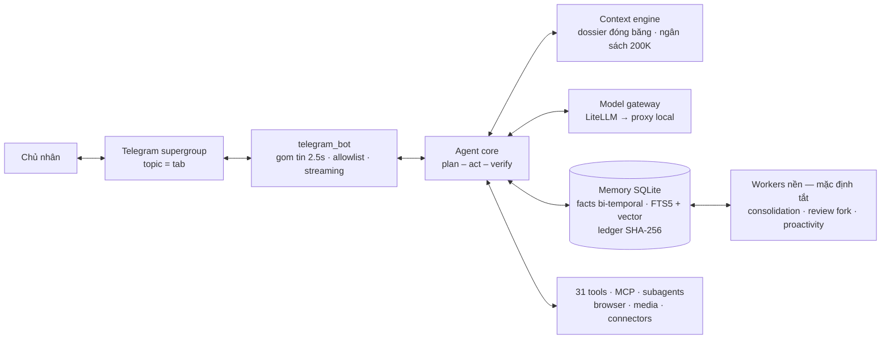

<p align="center">
  
</p>

<h1 align="center">Mulon</h1>

<p align="center">
  <strong>Trợ lý AI cá nhân chạy trong Telegram — nhớ lâu, làm việc thật, tự học từ mỗi lần bị sửa.</strong>
</p>

<p align="center">
  
  
  
  
  
</p>

Mulon là một personal AI agent hoàn chỉnh, viết từ đầu theo hướng
**harness-first**: cảm giác "dùng sướng" do khung vận hành bảo đảm —
ngữ cảnh tinh tuyển, vòng lặp có kế hoạch và kiểm chứng, ký ức có
cấu trúc — chứ không phụ thuộc vào độ mạnh của model. Ba ràng buộc
cứng của thiết kế:

- **Telegram-only.** Một supergroup riêng tư bật forum là toàn bộ
  giao diện; mỗi topic là một "tab". Từ 1.2.0 có thêm Mini App
  (bảng điều khiển chạy trong Telegram) cho cấu hình và duyệt
  việc — vẫn không kênh phụ nào ngoài Telegram.
- **Proxy-only.** Model chỉ được gọi qua một proxy local tương thích
  OpenAI (kiểu CLI-Proxy-API). Không dùng API chính thức của hãng
  nào, không khóa vào nhà cung cấp nào — đổi model là đổi cấu hình.
- **Opt-in tuyệt đối.** Mọi vòng lặp nền (lịch hẹn, consolidation,
  proactivity) mặc định **tắt**; chỉ chạy khi chủ nhân bật đích danh.

> Tài liệu thiết kế đầy đủ: [`docs/thiet-ke-ky-thuat-muse-clone.md`](docs/thiet-ke-ky-thuat-muse-clone.md) ·
> Kiến trúc module: [`ARCHITECTURE.md`](ARCHITECTURE.md)

## Mục lục

- [Tính năng](#tính-năng)
- [Kiến trúc](#kiến-trúc)
- [Bắt đầu nhanh](#bắt-đầu-nhanh)
- [Cấu hình](#cấu-hình)
- [Lệnh Telegram](#lệnh-telegram)
- [Công cụ dòng lệnh](#công-cụ-dòng-lệnh)
- [Kiểm thử & cổng chất lượng](#kiểm-thử--cổng-chất-lượng)
- [Nguyên tắc thiết kế](#nguyên-tắc-thiết-kế)
- [Cấu trúc thư mục](#cấu-trúc-thư-mục)
- [Backlog sau 1.0](#backlog-sau-10)
- [Giấy phép](#giấy-phép)

## Tính năng

**Vòng lặp làm việc có kiểm chứng.** Mọi yêu cầu đều chạy qua
plan → act → verify: kế hoạch lưu vào DB, các tool độc lập chạy
song song, một bước verify độc lập đối chiếu kết quả trước khi báo
xong; fail thì retry kèm chẩn đoán. Agent bị cấm nói "đã xong" khi
chưa kiểm chứng.

**Ký ức sống, truy được nguồn.** Fact lưu **bi-temporal** (bản cũ
bị thay thế chứ không xóa), recall **hybrid 70% vector / 30% BM25**
(embedding bge-m3 chạy local, degrade sạch về BM25 khi thiếu), đánh
chỉ mục lúc ghi nên truy vấn không cần LLM rerank. Consolidation
worker chắt lọc fact từ hội thoại; mọi thay đổi ký ức vào **sổ cái
append-only có SHA-256**, rollback được.

**Học từ correction theo vòng kín.** Khi chủ nhân sửa, hệ thống
phân loại lỗi theo taxonomy 5 loại, rút thành bài học có cấu trúc
và nạp vào ngữ cảnh các lượt sau. Correction nghiêm trọng tự sinh
test case vào bộ eval — lỗi đã sửa phải không bao giờ lặp lại.

**Ngữ cảnh chống rot.** Ngân sách cửa sổ 200K token được đếm trước
mỗi lời gọi; kết quả tool quá dài bị cắt và offload ra file;
trước khi nén hội thoại, một lượt **memory flush** trích fact để
không mất dữ kiện. Dữ liệu ngoài luôn được đóng khung chống
prompt injection.

**Tay chân đầy đủ.** 31 tool nội bộ (file, lệnh, web, ký ức, mục
tiêu, lịch…), **MCP client** theo SDK chính thức (stdio +
streamable HTTP), **subagent** là agent loop đầy đủ theo profile
(researcher / coder / default, tối đa 4 đồng thời), browser
Playwright, pipeline media bằng ffmpeg, khung connector trung
tính cho dịch vụ ngoài.

**Bề mặt group.** Topic = tab: Chat chính, Feed, Ideas, Goals,
Library, Lịch sử & Hệ thống. Feed sinh từ tư liệu nội bộ (không
aggregator), học gu qua reaction. Thẻ Ideas tự hết hạn sau 14
ngày, "làm luôn" là thành goal + task. Library có thùng rác khôi
phục được trong 30 ngày. Ngoài các tab cố định, `/chatphu <tên>`
tạo topic tự do làm đoạn chat phụ: lịch sử tách riêng theo topic,
ký ức dài hạn vẫn dùng chung, đóng/mở lại được bằng lệnh.

**An toàn theo thiết kế.** Allowlist cứng (chỉ chủ nhân ra lệnh
được; tin người lạ chỉ là dữ kiện), policy 2 lớp (file host thắng
phiên), **Secure Vault**: bí mật nhập qua form web dùng một lần,
giá trị không bao giờ đi qua chat hay log — agent chỉ cầm một
tham chiếu mờ. Scheduler/proactivity mặc định tắt.

**Giọng nói hai chiều.** Nghe bằng faster-whisper + một lượt model
rẻ hiểu ngữ; nói bằng TTS qua proxy. Vắng thành phần tùy chọn thì
degrade sạch, chat chữ vẫn chạy.

**Cứng hóa vận hành.** Bộ **eval vàng 30 case** chấm bằng máy với
cổng 85%, backup/restore có checksum SHA-256 toàn gói, báo cáo
sức khỏe (độ trễ p95, đường cong lỗi theo tuần, correction rate),
tracing Langfuse tùy chọn chỉ ghi metadata.

## Kiến trúc



| Module | Vai trò |
|---|---|
| `mulon/gateway.py` | LiteLLM → proxy: streaming, retry + circuit breaker, đếm token |
| `mulon/agent.py` | Vòng plan–act–verify, trần vòng lặp/token |
| `mulon/context.py` | Dossier snapshot, ngân sách token, memory flush, chống injection |
| `mulon/memory.py` | SQLite WAL: messages, facts bi-temporal, tasks, ledger, bề mặt Phase 6 |
| `mulon/embeddings.py` | bge-m3 qua FastEmbed (lazy), degrade BM25-only |
| `mulon/learning.py` | Bắt correction, taxonomy 5 loại, rút bài học, sinh eval case |
| `mulon/consolidation.py` | Worker chắt lọc fact từ episode |
| `mulon/tools.py` | Registry 31 tool, neo trong workspace |
| `mulon/mcp_client.py` | MCP stdio + streamable HTTP, tự reconnect |
| `mulon/subagents.py` | Agent loop đầy đủ theo profile, digest nén |
| `mulon/planning.py` · `mulon/cron.py` | Goals, tracked items, cron 5 trường tự viết |
| `mulon/proactivity.py` | Heartbeat gom việc → hàng đợi đề xuất (không tự gửi) |
| `mulon/voice.py` · `mulon/media_tools.py` | Whisper + TTS qua proxy · pipeline ffmpeg |
| `mulon/skills.py` | SKILL.md nạp dần (progressive disclosure) + vet tĩnh |
| `mulon/surfaces.py` · `feed.py` · `ideas.py` · `library.py` · `vault.py` | Bề mặt group: topics, Feed, Ideas, Library, Vault |
| `mulon/evals.py` · `backup.py` · `report.py` · `tracing.py` | Eval vàng, backup checksum, báo cáo sức khỏe, Langfuse |

## Bắt đầu nhanh

Yêu cầu: **Python 3.12+**, một proxy tương thích OpenAI đang chạy
local (mặc định `http://127.0.0.1:8317/v1`), và một bot Telegram
tạo qua [@BotFather](https://t.me/BotFather).

```bash
git clone https://github.com/mmmnhat/mulon-v2.git && cd mulon-v2
python3 -m venv .venv
.venv/bin/pip install -r requirements.txt
cp .env.example .env        # điền TELEGRAM_BOT_TOKEN + ALLOWED_USER_ID
.venv/bin/python -m mulon.main --dry-run   # smoke test, không cần token
.venv/bin/python -m mulon.main             # chạy bot
```

Hoặc bằng Docker:

```bash
cp .env.example .env        # điền 2 giá trị bắt buộc như trên
docker compose up -d
```

`ALLOWED_USER_ID` là Telegram user id của chính bạn (lấy ở
[@userinfobot](https://t.me/userinfobot)) — chỉ id này ra lệnh
được cho bot. Token bot chỉ để trong `.env` trên máy của bạn,
không commit, không gửi qua chat.

Thành phần tùy chọn: `fastembed` (vector recall), `faster-whisper`
(nghe giọng), `playwright` (browser), `langfuse` (tracing). Thiếu
cái nào thì tính năng đó tự tắt sạch, phần còn lại chạy bình thường.

## Cấu hình

Toàn bộ qua `.env` — xem [`.env.example`](.env.example) có chú
thích từng biến. Các biến chính:

| Biến | Mặc định | Ý nghĩa |
|---|---|---|
| `PROXY_BASE_URL` | `http://127.0.0.1:8317/v1` | Endpoint proxy model |
| `MODEL_BRAIN` / `MODEL_CHEAP` / `MODEL_ESCALATED` | `gemini-3.8-flash` | Model theo tầng việc |
| `TELEGRAM_BOT_TOKEN` | — | Token bot (bắt buộc) |
| `ALLOWED_USER_ID` | — | User id duy nhất được ra lệnh (bắt buộc) |
| `GROUP_MENTION_ONLY` | `1` | Trong group: chỉ đáp khi được nhắc/trả lời |
| `DEBOUNCE_SECONDS` | `2.5` | Gom tin liên tiếp thành một lượt |
| `CONTEXT_WINDOW_TOKENS` | `200000` | Ngân sách ngữ cảnh mỗi lượt |
| `EMBEDDER_BACKEND` | `fastembed` | `fastembed` · `stub` · `off` |
| `SCHEDULER_ENABLED` | `0` | Vòng lặp lịch hẹn (mặc định tắt) |
| `CONSOLIDATION_ENABLED` | `0` | Worker chắt lọc ký ức (mặc định tắt) |
| `PROACTIVITY_ENABLED` | `0` | Heartbeat chủ động (mặc định tắt) |
| `VAULT_PORT` | `8765` | Cổng form Vault trên 127.0.0.1 (`0` = tắt) |
| `WEBAPP_URL` | — | URL HTTPS công khai của Mini App (tunnel về `WEBAPP_PORT`) |
| `WEBAPP_APP_NAME` | — | Short name Mini App trong BotFather (`/myapps`) |
| `WEBAPP_PORT` | `8320` | Cổng Mini App server trên 127.0.0.1 |
| `APPROVAL_TIMEOUT_S` | `60` | Thẻ duyệt (policy nấc `ask`) hết hạn sau ngần này giây |

## Lệnh Telegram

| Nhóm | Lệnh |
|---|---|
| Lõi | `/start` `/status` `/new` — chốt phiên hiện tại · `/menu` — mở bảng điều khiển (Mini App) |
| Group | `/setup_topics` — tạo các topic-tab · `/topics` — xem map |
| Chat phụ | `/chatphu <tên>` — tạo đoạn chat phụ · `/chatphu_list` · `/dongchat` · `/chatphu_dong <thread_id>` · `/chatphu_mo <thread_id>` |
| Feed | `/feed_now` — sinh bài mới · `/feedbrief <nội dung>` — sửa brief |
| Ideas | `/ideas` · trả lời thẻ "làm luôn" hoặc `/idea_do <id>` · `/idea_bo <id>` |
| Đề xuất | `/notes` — đề xuất đang chờ · `/note_ok <id>` · `/note_bo <id>` |
| Library | `/library` · `/trash_item <id>` · `/restore_item <id>` · `/share_item <id>` |
| Ký ức | `/memory` — fact kèm nguồn · `/forget <chủ đề>` — quên theo kế hoạch, xác nhận "quên thật" · `/export_memory` · `/import_memory` (gửi kèm file) |
| Khác | `/vault <nhãn>` — link form nhập bí mật · `/quyen` — policy bằng lời thường · `/approvals` — lịch sử quyết định · `/voiceon` `/voiceoff` |

Trong group có người khác, bot chỉ lên tiếng khi được nhắc tên,
được trả lời trực tiếp, hoặc đúng lệnh của chủ nhân.

## Bảng điều khiển (Mini App)

Từ 1.2.0, gõ `/menu` trong chat: bot gửi một tin gọn kèm nút mở
**Mini App** phủ lên chat kiểu modal — mọi cấu hình và chi tiết
tiến trình nằm trong app, không nằm trong chat:

- **Việc** — các lượt việc gần nhất; bấm một lượt xem timeline
  từng bước + tóm tắt kết quả.
- **Phê duyệt** — việc đang chờ duyệt (Duyệt / Chặn / Duyệt và
  nhớ) + lịch sử phê duyệt dạng bảng trường.
- **Lịch** — việc hẹn giờ + heartbeat, bật/tắt tại chỗ.
- **Hồ sơ** — thẻ Hồ sơ & Bộ nhớ (xem nội dung dossier/facts,
  chỉ chủ nhân) + số kỹ năng đã nạp.
- **Cài đặt** — Công cụ kết nối (connector/MCP + công tắc), Kho
  lưu trữ an toàn (chỉ nhãn + ref, không giá trị), Quyền
  (segmented 3 nấc Cho phép / Hỏi / Chặn cho từng nhóm việc và
  từng tool, lưu phiên hoặc lưu bền vào file policy).

Policy có nấc thứ ba là **"hỏi"** (`ask`): việc thuộc nấc này sẽ
hiện *thẻ duyệt* ngay trong topic đang chạy — quyết định xong
(duyệt, chặn hay hết hạn 60s) bot **tự xóa thẻ**, quyết định lưu
vào lịch sử duyệt. Không có Mini App vẫn duyệt được bằng nút
inline trên thẻ.

Cách bật Mini App (3 bước, làm một lần):

1. Dựng tunnel HTTPS về `127.0.0.1:8320`, ví dụ
   `cloudflared tunnel --url http://127.0.0.1:8320` hoặc
   `tailscale funnel 8320` — lấy URL HTTPS đó làm `WEBAPP_URL`.
2. Trong BotFather: `/myapps` → tạo app cho bot, đặt short name
   (ví dụ `panel`) làm `WEBAPP_APP_NAME`, Web App URL = `WEBAPP_URL`.
3. Đặt hai biến vào `.env` rồi khởi động lại bot.

Bot mở app bằng **Direct Link**
(`https://t.me/<bot>/<app>?startapp=...&mode=compact`) — chạy
được cả trong group lẫn DM. Mọi API của app đều khóa bằng chữ ký
`initData` của Telegram + đúng `ALLOWED_USER_ID`; thiếu cấu hình
thì tính năng degrade sạch về inline như trên.

Giao diện app theo design system riêng — token màu lấy mẫu từ
chính nhân vật Mulon, kỷ luật màu 60/30/10, responsive
360→desktop: xem [`mulon/webapp/DESIGN.md`](mulon/webapp/DESIGN.md).

> **Tuỳ chọn cho chủ bot — video hồ sơ:** Telegram cho bot đặt
> một *video hồ sơ* qua BotFather (clip lặp 800×800, H.264,
> tối đa 10 giây, tối đa 2MB, không tiếng). Đó chỉ là MỘT clip
> duy nhất cho mọi hoàn cảnh — không đổi theo trạng thái. Các
> trạng thái thật của avatar (rảnh / đang làm / chờ duyệt /
> xong / lỗi) chỉ có bên trong Mini App, vẽ bằng CSS trên ảnh
> tĩnh sẵn có.

## Công cụ dòng lệnh

| Lệnh | Việc |
|---|---|
| `python -m mulon.main [--dry-run]` | Chạy bot / kiểm tra cấu hình |
| `python -m mulon.evals [--live] [--json]` | Chạy bộ eval vàng, áp cổng chất lượng |
| `python -m mulon.backup create\|list\|restore` | Sao lưu / khôi phục có checksum |
| `python -m mulon.report [--json]` | Báo cáo sức khỏe + đường cong học |
| `python -m mulon.consolidation --once` | Chạy tay một lượt chắt lọc ký ức |
| `python -m mulon.proactivity --once` | Chạy tay một nhịp heartbeat |

## Kiểm thử & cổng chất lượng

```bash
.venv/bin/pip install -r requirements-dev.txt
.venv/bin/python -m pytest tests/ -q     # 221 test
.venv/bin/python -m mulon.evals          # stub offline: 30/30, cổng 85%
```

Bộ eval vàng (`evals/golden.jsonl`) gồm 30 case thuộc 5 họ: trí
nhớ, correction, dùng tool, trung thực khi thiếu dữ kiện, giọng.
Chấm hoàn toàn bằng máy — không LLM-judge. `--live` đo cả model
thật qua proxy với cùng bộ case. CI (GitHub Actions) chạy pytest
+ dry-run và dùng eval stub làm cổng merge.

## Nguyên tắc thiết kế

1. **Harness bảo đảm cảm giác, model chỉ làm nó tốt hơn.** Việc
   được chia nhỏ, ngữ cảnh được tinh tuyển, kết quả được kiểm
   chứng và sửa kèm chẩn đoán, tool trả dữ liệu đã tiêu hóa, đầu
   ra được định hình — nên thay model nào (kể cả bản Flash) trải
   nghiệm vẫn đứng vững.
2. **Càng làm càng khôn, càng khôn càng nhanh.** Bài học từ
   correction, digest sau mỗi lượt và đường cong lỗi theo tuần là
   số liệu vận hành thật, không phải khẩu hiệu.
3. **Không có gì tự chạy khi chưa được bật đích danh.** Mọi
   vòng lặp nền đều opt-in; heartbeat có việc cũng chỉ xếp hàng
   chờ duyệt, không tự gửi.
4. **Bí mật không đi qua agent.** Vault giữ giá trị ở file quyền
   0600; agent chỉ cầm tham chiếu. Log và trajectory không chứa
   nội dung bí mật, kể cả trong trace.
5. **Trung thực về giới hạn.** Tính năng chưa có nằm ở backlog,
   trạng thái chưa chắc chắn được nói là chưa chắc chắn — trong
   tài liệu này và trong câu trả lời của chính agent.

## Cấu trúc thư mục

```
mulon/          Mã nguồn agent (gateway, core, memory, surfaces…)
tests/          221 test — mỗi phase một cụm test riêng
dossier/        SOUL / IDENTITY / USER / MEMORY / FEED / HEARTBEAT…
docs/           Tài liệu thiết kế kỹ thuật đầy đủ
evals/          Bộ eval vàng (golden.jsonl) + case sinh từ correction
skills/         SKILL.md nạp dần, qua vet tĩnh trước khi dùng
config/         policy.json (policy 2 lớp), mcp_servers.json
assets/         Avatar và tài nguyên tĩnh
Dockerfile · docker-compose.yml
```

## Backlog sau 1.0

Ghi trung thực những gì bản 1.0.0 chưa có:

- Worker tổng hợp alignment hằng ngày (hiện dossier alignment
  còn tĩnh).
- Tách fact thành trang `people/*.md` / `groups/*.md`.
- Thủ tục hóa: việc quen lặp lại ≥3 lần thành plan template/skill
  đóng gói.
- Adapter connector cho dịch vụ thật (hiện mới có khung + adapter
  `system`).
- MCP OAuth đầy đủ (HTTP hiện ở mức header từ env).
- Đóng gói dashboard Langfuse self-host chạy kèm.
- Nạp nóng skill không cần khởi động lại bot.

## Giấy phép

[MIT](LICENSE) © 2026 Mulon contributors.
