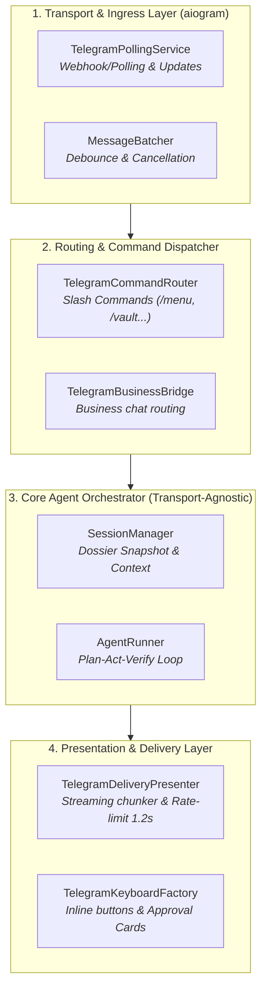

# ADR-001: Phân Tách Kiến Trúc Ingress Telegram và Agent Loop (Decoupling Telegram Transport from Agent Orchestration)

> **Trạng thái**: Đề xuất (Proposed) — Thuộc Chặng 1 & 2 của Kế hoạch [T-39]  
> **Chủ trì**: `agency-software-architect` & `agency-backend-architect`  
> **Ngày lập**: 30/10/2026  
> **Tác động**: `mulon/telegram_bot.py` (5,086 dòng), `mulon/telegram_delivery.py`, `mulon/agent.py`  

---

## 1. Ngữ cảnh (Context)

File `mulon/telegram_bot.py` hiện tại là "siêu module" lớn nhất dự án với **5,086 dòng code**, gánh đồng thời 6 trách nhiệm kiến trúc khác nhau:
1. **Transport & Ingress**: Đăng ký bot aiogram 3, quản lý polling loop, xử lý webhook/tunnel.
2. **Batching & Cancellation**: Bộ đệm tin nhắn vụn (`MessageBatcher`), kiểm tra intent huỷ việc (`cancellation_markers.json`).
3. **Telegram UI & Message Formatting**: Sinh mã HTML Telegram, format bảng, chia chunk tin dài, debounce tiến trình sửa tin (rate limit 1.2s).
4. **Command Handlers**: Xử lý hơn 25 lệnh Telegram bot (`/start`, `/menu`, `/tasks`, `/models`, `/vault`, `/voiceon`, `/cancel`...).
5. **Business Customer Bot**: Xử lý tin nhắn khách hàng doanh nghiệp, phân loại khách hàng, sinh bản thảo và thẻ inline keyboard (`mulon/business.py`).
6. **Agent Invocation**: Khởi tạo session, nạp dossier, gọi `Agent.handle()`, nhận streaming events và ghi trajectory.

### Điểm nghẽn phát sinh:
- **Độ ghép nối cao (High Coupling)**: Mọi thay đổi ở logic giao diện Telegram (như đổi icon, sửa rate limit sửa tin) đều đụng vào cùng file với logic gọi AI Agent và routing lệnh.
- **Rủi ro hồi quy (Regression Risk)**: Mỗi lần push lên `main`, bot trên máy Mac tự động khởi động lại qua `auto_watch.py` sau ~15s. Sửa một file 5,000 dòng tạo rủi ro lớn làm gián đoạn bot thật.
- **Khó khăn trong kiểm thử đơn vị**: Test các hàm xử lý tin nhắn phải mock một cấu trúc aiogram Update/Message rất cồng kềnh.

---

## 2. Quyết định Đề xuất (Decision)

Áp dụng mẫu kiến trúc **Ports and Adapters (Hexagonal Architecture)** để phân tách `telegram_bot.py` thành 4 lớp độc lập theo các lát cắt nhỏ (Tracer Bullets), không refactor ồ ạt:

### Chi tiết 4 phân lớp:
1. **`mulon/telegram_ingress.py` (Mới)**:
   - Chỉ chịu trách nhiệm quản lý lifecycle của aiogram Dispatcher, Bot instance, và `MessageBatcher`.
   - Nhận Update từ Telegram và chuyển thẳng thành Domain Event nội bộ (`UserTextMessage`, `UserVoiceMessage`, `UserCallbackQuery`).
2. **`mulon/telegram_commands.py` (Mở rộng từ commands.py)**:
   - Tách toàn bộ các handler lệnh slash `/...` ra khỏi file bot chính.
   - Mỗi lệnh là một handler độc lập, nhận `CommandContext` và trả kết quả.
3. **`mulon/telegram_delivery.py` (Chuẩn hoá)**:
   - Tập trung toàn bộ logic render HTML tin nhắn Telegram, chia nhỏ khối văn bản (chunking <4096 ký tự), cơ chế throttle/debounce khi sửa tin nhắn tiến trình (`✓` / `⏳`).
4. **`mulon/telegram_bot.py` (Thu gọn còn <1,200 dòng)**:
   - Đóng vai trò Glue Code kết nối Ingress -> Router -> Agent Core -> Delivery.

---

## 3. Hệ quả & Lợi ích (Consequences)

### Tích cực:
- **Dễ bảo trì & Mở rộng**: Kích thước file giảm từ 5,086 dòng xuống các module chuyên biệt ~600-1,200 dòng, tuân thủ nguyên tắc Single Responsibility.
- **An toàn triển khai**: Có thể sửa logic giao diện Telegram (Presentation) mà không chạm vào lõi Agent Loop.
- **Testability**: Có thể viết unit test riêng cho logic chia chunk, format bảng, và debounce tin nhắn mà không cần khởi động aiogram bot.

### Ràng buộc thực thi (Theo Điều kiện 3 của Muse):
- **Tuyệt đối không Big-Bang Refactor**: Việc phân tách sẽ KHÔNG thực hiện trong Chặng 1 & 2.
- Khi triển khai ở Chặng 3, việc tách phải đi từng lát cắt nhỏ (Sub-tasks: `T-39.6a`, `T-39.6b`...). Mỗi lát cắt phải kèm suite test xanh 100% và kiểm chứng bot sống trên Telegram thật.
