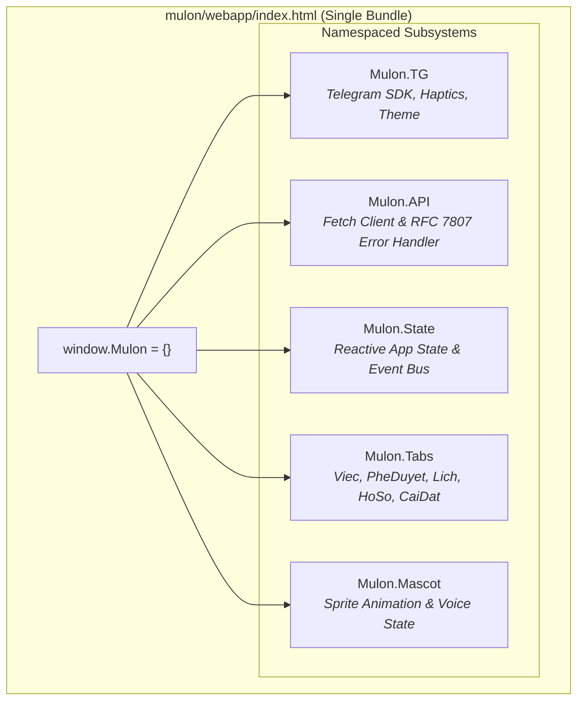

# ADR-002: Kế Hoạch Module Hoá Mã Nguồn JS Mini App (ISSUE-08 / T-39.4b)

> **Trạng thái**: Đề xuất (Proposed) — Chuẩn bị cho giai đoạn mở rộng [T-39.4b]  
> **Chủ trì**: `agency-frontend-developer` & `agency-software-architect`  
> **Ngày lập**: 31/10/2026  
> **Tác động**: `mulon/webapp/index.html` (7,536 dòng, khối script ~5,400 dòng), `mulon/webapp_server.py`  

---

## 1. Ngữ cảnh & Vấn đề (Context & Risks)

Khối mã JavaScript trong `mulon/webapp/index.html` hiện có độ dài hơn **5,400 dòng**, chứa toàn bộ logic tương tác của 5 tab chính (Việc, Phê duyệt, Lịch, Hồ sơ, Cài đặt), các modal chi tiết, cơ chế kết nối SSE/polling, Telegram WebApp SDK bindings và Mascot sprite animator.

### Các rủi ro kiến trúc phát hiện (ISSUE-08):
1. **Ô nhiễm không gian tên toàn cục (Global Scope Pollution)**: Các biến trạng thái (`tasks`, `currentTab`, `broker_pending`, `ws_connected`...) và các hàm tiện ích nằm lẫn lộn ở phạm vi toàn cục `window`, tiềm ẩn rủi ro ghi đè biến chéo nhau giữa các màn hình.
2. **Nguy cơ rò rỉ bộ nhớ (Memory & Event Listener Leaks)**: Khi người dùng chuyển đổi tab liên tục trên thiết bị di động, các event listener gắn trực tiếp vào DOM không được huỷ đồng bộ.
3. **Ràng buộc hạ tầng Telegram & Server Serving**:
   - Máy chủ `mulon/webapp_server.py` hiện được thiết kế bảo mật tối đa: **Single-File Delivery** (`/` phục vụ `index.html`) và chỉ whitelist đúng 2 asset tĩnh (`sprite-sheet-alpha.png`, `mulon-states-manifest.json`).
   - Dự án MuLon **không dùng Node.js, Webpack hay npm**; toàn bộ dependencies là Python thuần.
   - Ứng dụng chạy qua Cloudflare Tunnel tạm thời (`trycloudflare`) hoặc domain nội bộ; việc phân tán thành nhiều file `.js` tải bất đồng bộ dễ gặp lỗi cache trình duyệt di động, chặn MIME type hoặc độ trễ round-trip (RTT) trên mạng di động 4G.

---

## 2. So Sánh Các Phương Án Kỹ Thuật (Architecture Options)

| Tiêu chí | Phương án A: In-Place Namespace/IIFE (Đề xuất) | Phương án B: Multi-file Build Inliner | Phương án C: Native ESM via Whitelist Routes |
|---|---|---|---|
| **Cơ chế** | Tách khối code thành các Module Object tự đóng gói (IIFE) ngay trong `index.html` (`Mulon.State`, `Mulon.API`, `Mulon.Tabs.*`). | Chia các file `.js` vào `mulon/webapp/src/` và dùng script Python (`scripts/build_webapp.py`) ghép nối vào `index.html`. | Tách file `.js` thật, mở route `/assets/js/{name}` trong `webapp_server.py` và dùng `<script type="module">`. |
| **Bảo mật & Server** | Không đổi server, không mở route mới, không nguy cơ path traversal. | Không đổi server, file phát hành vẫn là single-bundle. | Phải cấu hình thêm MIME type, whitelist route tĩnh trong `webapp_server.py`. |
| **Hiệu năng di động** | Tối ưu: 1 HTTP request duy nhất, 0 RTT phụ, nạp tức thì trong WebView Telegram. | Tối ưu: 1 HTTP request duy nhất. | Chậm: 5–8 HTTP requests phụ cho từng module ESM, phụ thuộc độ trễ Cloudflare. |
| **Quy trình Build** | Không cần bước build; sửa trực tiếp, kiểm thử tức thì. | Thêm bước build Python trước khi chạy bot / test; rủi ro lệch đồng bộ giữa src và dist. | Không cần build, nhưng phải xử lý CORS / Cache-Control trên từng file. |
| **Độ rủi ro hồi quy** | 🟢 **THẤP NHẤT**: Giữ nguyên cơ chế serving, chỉ đóng gói phạm vi biến. | 🟡 **TRUNG BÌNH**: Rủi ro quên chạy build script khi dev trên Mac. | 🔴 **CAO NHẤT**: Rủi ro lỗi MIME type, cache Telegram WebView, lỗi network hop. |

---

## 3. Quyết định Đề xuất (Decision)

Áp dụng **Phương án A (In-Place Namespace & Subsystem Decoupling)** kết hợp nguyên tắc **Ponytail** (đơn giản, tinh gọn, không sinh phụ thuộc):

### Kế hoạch phân rã 3 lát cắt nhỏ (Tracer Bullets) cho T-39.4b:
1. **Lát cắt 1 (Core & API Subsystem)**:
   - Đóng gói `Mulon.TG` (BackButton, HapticFeedback, initData) và `Mulon.API` (`api(path, method, body)` chuẩn hoá bắt lỗi RFC 7807).
   - Kiểm chứng tương thích 100% với các test Playwright hiện có.
2. **Lát cắt 2 (Mascot & State Bus)**:
   - Đóng gói bộ điều khiển Sprite Mascot và Event Bus chia sẻ trạng thái giữa các tab.
3. **Lát cắt 3 (Tabs Decoupling)**:
   - Tách các hàm render và event handlers của 5 tab vào namespace `Mulon.Tabs[tabName]`.
   - Cung cấp phương thức `destroy()` / `cleanup()` khi rời tab để giải phóng event listener.

---

## 4. Bằng Chứng & Tiêu Chí Nghiệm Thu Cho T-39.4b
1. Toàn bộ biến toàn cục được thu gọn vào `window.Mulon`.
2. Không sinh thêm request HTTP ngoài khi mở Mini App.
3. Test suite Playwright `tests/test_v17_design_system_and_native.py` và full suite $\ge 749$ test tiếp tục PASS 100%.
4. Tiến trình tự thoát sạch sau summary.
