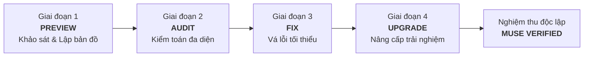

# Kế hoạch Đa Tác Tử: Preview — Audit — Fix — Upgrade MuLon
> **Mục tiêu**: Ứng dụng đội ngũ 85 Specialized Agents từ Agency (`~/.gemini/config/skills/agency-*`) để rà soát, kiểm toán, khắc phục và nâng cấp toàn diện dự án MuLon (v1.7.47+).  
> **Người lập**: Antigravity (Builder)  
> **Người duyệt**: Muse (Reviewer)  
> **Quyết định tối cao**: Chủ dự án (`mmmnhat`)  

---

## 1. Bối cảnh & Nguyên tắc cốt lõi

MuLon hiện tại đã đạt phiên bản **v1.7.47** với hơn 713+ unit/integration tests xanh, hệ thống đã hoàn tất các mốc parity nền tảng (gộp tin, sub-agent song song, Mini App W3C polish, Telegram Business nháp tin theo ngữ cảnh). 

Để đưa MuLon từ một bản clone hoạt động ổn định lên chuẩn sản phẩm cá nhân hoàn thiện, thông minh và bền bỉ, chúng tôi đề xuất quy trình 4 giai đoạn chuẩn mực **Preview -> Audit -> Fix -> Upgrade**, phân công cụ thể cho các AI Agent chuyên trách đã được tích hợp trong hệ thống.

### Nguyên tắc bất biến tuân thủ (AGENTS.md):
1. **Telegram-only & Proxy-only**: Mọi tính năng chỉ phục vụ qua Telegram + Mini App; LLM chỉ qua local proxy `127.0.0.1:8317`.
2. **Nguyên tắc số 0 (Zero Hardcode)**: Tuyệt đối không hardcode giá trị biến thiên; cấu hình nạp qua env/json/prompts.
3. **Degrade, không sập**: Thiếu dịch vụ/tính năng tuỳ chọn thì degrade êm ái, có log cảnh báo.
4. **Mini App chuẩn thiết kế**: Render thật, tỷ lệ màu 60/30/10 (tím Mulon là màu nhấn duy nhất), không dùng emoji trang trí, lưới 8pt.
5. **Kỷ luật Git & Phối hợp**: GitHub `main` là nguồn sự thật duy nhất; Muse độc lập nghiệm thu (`VERIFIED`); Antigravity thực thi (`DONE`).

---

## 2. Bản đồ 4 Giai đoạn & Phân công Agent

---

### GIAI ĐOẠN 1: PREVIEW (Khảo sát & Lập bản đồ hiện trạng)
*Mục tiêu: Đánh giá tổng thể bức tranh kiến trúc, phụ thuộc và trải nghiệm người dùng hiện tại mà không thay đổi code.*

| Agent chuyên trách | Vai trò & Nhiệm vụ cụ thể | Sản phẩm đầu ra |
|---|---|---|
| **`agency-codebase-onboarding-engineer`** | Đọc lướt và phân tích 26 module Python, 89 biến môi trường, hệ thống router và bảng dữ liệu SQLite. | Báo cáo kiến trúc hiện trạng (Codebase Map), sơ đồ phụ thuộc module. |
| **`agency-software-architect`** | Đối chiếu cấu trúc hiện tại với tài liệu `docs/technical-reference.md` và `ARCHITECTURE.md`, tìm các điểm thắt nút (bottlenecks) hoặc ranh giới module bị mờ nhạt. | Đánh giá kiến trúc phân lớp (DDD / Modular Monolith Review). |
| **`agency-ux-architect`** | Trải nghiệm luồng tương tác Mini App trên Telegram Webview, phân tích hành trình người dùng (User Journey) từ tin nhắn chat sang Mini App. | Bản đồ trải nghiệm & Navigation hierarchy audit. |

---

### GIAI ĐOẠN 2: AUDIT (Kiểm toán chuyên sâu đa chiều)
*Mục tiêu: Soi từng góc khuất của hệ thống về bảo mật, cơ sở dữ liệu, retrieval RAG, chất lượng UI và mã nguồn.*

| Chi nhánh kiểm toán | Agent chủ trì | Trọng tâm kiểm tra |
|---|---|---|
| **Bảo mật & Quyền riêng tư** | `agency-application-security-engineer` `agency-privacy-engineer` | - Kiểm toán denylist các file nhạy cảm (`.env*`, `*.key`, `*.db`). - Kiểm tra injection vector tại `frame_external` và URL fetching qua `assert_url_public`. - Kiểm tra cơ chế xác thực HMAC `initData` của Mini App và chính sách cấp quyền connector. |
| **Cơ sở dữ liệu & Ký ức** | `agency-database-optimizer` `agency-database-reliability-engineer` | - Rà soát SQLite WAL: chỉ mục FTS5, bảng `vec0`, hiệu năng câu truy vấn tìm kiếm ký ức. - Kiểm toán cơ chế trích xuất fact sinh học (bi-temporal facts), xử lý cạnh tranh (concurrency) trên connection SQLite. - Kiểm tra chiến lược dọn dẹp TTL rác (`data/artifacts/tool-results/`). |
| **Hệ thống RAG & Context** | `agency-rag-pipeline-engineer` `agency-autonomous-optimization-architect` | - Kiểm toán thuật toán hybrid search (70% vector + 30% BM25). - Ngân sách ngữ cảnh 200K token: cơ chế trim, compaction, bài học (`lesson:*`). - Phân bổ 3 tier model (Brain / Cheap / Escalated), đo đếm token và latency. |
| **Độ hoàn thiện UI/UX** | `agency-ui-finish-gate-reviewer` `agency-accessibility-auditor` | - Thẩm định render thật HTML/CSS của Mini App bằng Chromium. - Soi chuẩn W3C, phát hiện triệt để các style inline dư thừa, lỗi layout, overflow. - Rà soát độ tương phản màu, kích thước touch target (thumb zone), chống rập khuôn. |
| **Chất lượng code & Bloat** | `agency-code-reviewer` `agency-reality-checker` | - Rà soát mã nguồn thừa, over-engineering (Ponytail review). - Thẩm định tính xác thực của các tính năng (chặn "fantasy approvals", kiểm chứng bằng log và test thật). |

---

### GIAI ĐOẠN 3: FIX (Khắc phục triệt để & Vá lỗi tối thiểu)
*Mục tiêu: Sửa chữa các tồn đọng phát hiện từ đợt Audit theo phương châm an toàn tuyệt đối.*

| Nguyên tắc thực thi | Agent phụ trách | Cách thức triển khai |
|---|---|---|
| **Minimal Diff Discipline** | `agency-minimal-change-engineer` | Sửa đúng chỗ đau, không refactor tràn lan; ưu tiên giải pháp ít dòng nhất và tận dụng thư viện chuẩn (stdlib). |
| **Test-Driven Regression** | `agency-test-automation-engineer` `agency-api-tester` | Mọi lỗi sửa đều phải có unit test / regression test đi kèm; bảo đảm 100% test suite xanh trước khi commit. |
| **Clean Git Execution** | `agency-git-workflow-master` | Tách commit theo từng atomic task, thông điệp conventional chuẩn mực (`fix(scope): ...`), rebase sạch sẽ. |

---

### GIAI ĐOẠN 4: UPGRADE (Nâng tầm trải nghiệm & Năng lực hệ thống)
*Mục tiêu: Mở rộng tính năng để MuLon đạt độ mượt mà và cá tính như trợ lý Muse thực thụ.*

1. **Điều phối Đa Tác Tử nâng cao (Multi-Agent Orchestration)**:
   - *Agent*: `agency-multi-agent-systems-architect`
   - *Nội dung*: Nâng cấp `SubagentRunner`, tối ưu hóa việc phân tách tác vụ song song (`spawn_subagents_parallel`), nén digest trả về, hiển thị trực quan trạng thái từng sub-agent trên tab Việc của Mini App.
2. **Cá tính & Tương tác thông minh (Delight & Micro-interactions)**:
   - *Agent*: `agency-whimsy-injector` & `agency-visual-storyteller`
   - *Nội dung*: Tinh chỉnh phản hồi giọng văn tự nhiên (Nam bộ / thông minh), bổ sung các trạng thái chuyển động vi mô êm ái trên Mini App, giữ đúng quy định không dùng emoji làm icon trạng thái.
3. **Đo lường hiệu năng & Chứng cứ sống (Live Evidence & Benchmarking)**:
   - *Agent*: `agency-performance-benchmarker` & `agency-evidence-collector`
   - *Nội dung*: Benchmark tốc độ phản hồi Telegram, tối ưu thời gian khởi động bot, xuất báo cáo nghiệm thu kèm ảnh chụp màn hình render thật và log tương tác thực tế.

---

## 3. Quy trình Trình duyệt & Phối hợp với Muse

1. **Trình duyệt Plan (Bước hiện tại)**:
   - Antigravity mở nhiệm vụ **`[T-39]`** trong `AGENT_TASKS.md`, commit và push lên `origin/main`.
   - Muse autowatch kéo về, rà soát tính khả thi và phản hồi (Duyệt / Điều chỉnh).
2. **Thực thi từng chặng**:
   - Mỗi giai đoạn (Preview, Audit, Fix, Upgrade) sẽ được Antigravity thực hiện độc lập, commit với nhãn tương ứng.
   - Khi hoàn thành mỗi đợt, Antigravity báo cáo theo chuẩn 5 ý tại `AGENT_TASKS.md` và chuyển trạng thái sang `DONE`.
3. **Nghiệm thu độc lập**:
   - Muse pull code, chạy lại toàn bộ test suite, kiểm tra diff và nghiệm thu sống để cấp dấu `VERIFIED`.
