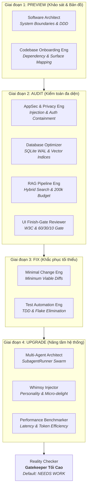

# KẾ HOẠCH HỘI ĐỒNG TÁC TỬ (AGENCY COUNCIL PLAN)
# Preview — Audit — Fix — Upgrade Toàn Diện MuLon (v1.7.47+)

> **Cơ chế thực thi**: Phối hợp đa tác tử dựa trên 85 Agent Personas từ The Agency (`~/.gemini/config/skills/agency-*`).  
> **Chủ trì kỹ thuật**: Antigravity (Mac Builder)  
> **Thẩm định & Kiểm chứng độc lập**: Muse (VM Reviewer)  
> **Cơ quan phê duyệt tối cao**: Chủ dự án (`mmmnhat`)  
> **Nguyên tắc nền tảng**: Tuân thủ triệt để `AGENTS.md` (Zero Hardcode, Telegram-only, Proxy-only, Degrade không sập, 60/30/10 Mini App).

---

## 1. TỔNG QUAN KIẾN TRÚC & PHÂN CÔNG HỘI ĐỒNG (AGENCY ROSTER)

Toàn bộ kế hoạch được bảo chứng bởi các Agent chuyên trách, mỗi agent chịu trách nhiệm sinh mệnh kỹ thuật trong phân vùng của mình:

---

## 2. Ý KIẾN CHUYÊN MÔN & KẾ HOẠCH TỪNG AGENT

### 🏛️ Phân hệ 1: Kiến trúc & Ranh giới Hệ thống
*Chủ trì: `agency-software-architect` & `agency-backend-architect`*

* **Chẩn đoán hiện trạng (41,210 dòng code Python / 60 modules)**:
  * Hai "siêu module" đang gánh quá nhiều trách nhiệm: `mulon/telegram_bot.py` (5,086 dòng) và `mulon/webapp_server.py` (4,654 dòng). Việc dồn logic xử lý dữ liệu và định tuyến giao diện vào cùng một file làm tăng độ ghép nối (coupling).
  * Chiều phụ thuộc (Dependency Direction): Cần bảo đảm tầng domain lõi (`policy.py`, `context.py`, `memory.py`) không bị phụ thuộc ngược vào transport Telegram (`aiogram`) hay Web (`aiohttp`).
* **Hành động cụ thể (Tasks)**:
  - [ ] **Task ARCH-1**: Lập ma trận phụ thuộc giữa 60 modules, xác định các điểm rò rỉ ranh giới (leaky abstractions).
  - [ ] **Task ARCH-2 (ADR-001)**: Đề xuất bản Architecture Decision Record tách mạch Transport (Telegram Events/Handlers) ra khỏi Agent Orchestration trong `telegram_bot.py`.
  - [ ] **Task ARCH-3**: Rà soát lại Circuit Breaker và ngân sách timeout tại `mulon/gateway.py`, bảo đảm mọi lời gọi ra ngoài proxy `127.0.0.1:8317` đều có fallback tất định.

---

### 🗄️ Phân hệ 2: Cơ sở dữ liệu, Vector & Bộ nhớ
*Chủ trì: `agency-database-optimizer` & `agency-database-reliability-engineer`*

* **Chẩn đoán hiện trạng (`mulon/memory.py` - 2,617 dòng, SQLite WAL)**:
  * Hệ thống lưu trữ SQLite WAL phục vụ đồng thời FTS5 (`messages_fts`), bảng vector `vec0` (sqlite-vec), lịch trình, task, trajectory và sự kiện học (`learning.py`).
  * Cần rà soát nguy cơ nghẽn single-writer khi bot vừa stream tin nhắn, vừa ghi trajectory vừa chạy consolidation nền.
* **Hành động cụ thể (Tasks)**:
  - [ ] **Task DB-1**: Kiểm toán toàn bộ câu truy vấn tìm kiếm ký ức kết hợp (Hybrid Search: 70% vector + 30% BM25), bảo đảm latency dưới 20ms với bộ dữ liệu >50,000 facts.
  - [ ] **Task DB-2**: Rà soát locking behavior và `PRAGMA busy_timeout` (hiện đặt 30.0s), chống nghẽn aiosqlite worker threads lúc teardown test.
  - [ ] **Task DB-3**: Thiết lập cơ chế tự động dọn rác TTL cho thư mục `data/artifacts/tool-results/` để tránh phình dung lượng disk.

---

### 🧠 Phân hệ 3: RAG, Ngữ cảnh 200K & Model Routing
*Chủ trì: `agency-rag-pipeline-engineer` & `agency-autonomous-optimization-architect`*

* **Chẩn đoán hiện trạng (`mulon/context.py`, `mulon/gateway.py`)**:
  * Cơ chế nén ngữ cảnh và ngân sách 200k token (`ContextEngine`) cần chống hiện tượng "mất tập trung" (lost in the middle) khi nhồi dossier, bài học và lịch sử chat.
  * Phân tầng 3 tier model: `brain` (mô hình suy luận lớn), `cheap` (mô hình rẻ cho phân loại/tiền xử lý), `escalated` (mô hình tối thượng cho lập trình sâu).
* **Hành động cụ thể (Tasks)**:
  - [ ] **Task RAG-1**: Đánh giá độ phủ và độ chính xác của hybrid search trên tập vàng 36 evals (`mulon.evals`), mục tiêu kéo tỷ lệ đỗ từ 92% (33/36) lên 100%.
  - [ ] **Task RAG-2**: Tối ưu hóa chu trình tải trọng số FastEmbed ONNX local (`bge-m3` / `multilingual-e5-large`), đảm bảo zero-cold-start khi bot reboot.
  - [ ] **Task RAG-3**: Kiểm toán bộ router model, bảo đảm các tác vụ nhẹ (như phân loại chào kết Telegram Business, nhận diện sửa lỗi) luôn chạy trên tier cheap với token tiết kiệm nhất.

---

### 🛡️ Phân hệ 4: Bảo mật & Quyền riêng tư
*Chủ trì: `agency-application-security-engineer` & `agency-privacy-engineer`*

* **Chẩn đoán hiện trạng (Chốt bảo mật mục 5 trong `AGENTS.md`)**:
  * Quy tắc bảo mật cốt lõi: Denylist file nhạy cảm (`.env*`, `*.pem`, `*.key`, `*.db`, `vault.json`).
  * Khung dữ liệu ngoài `frame_external` phải chống prompt injection từ web, email, transcript tool.
* **Hành động cụ thể (Tasks)**:
  - [ ] **Task SEC-1**: Fuzz testing hàm `_resolve_for_file_tool` và gateway multimodal để chứng minh không có đường path traversal nào vượt qua được denylist.
  - [ ] **Task SEC-2**: Rà soát xác thực HMAC `initData` của Telegram Mini App (`mulon/webapp_server.py`), kiểm tra replay attack window và time drift.
  - [ ] **Task SEC-3**: Kiểm toán luồng `assert_url_public`, bảo đảm phòng chống triệt để tấn công SSRF và DNS-rebinding TOCTOU khi bot fetch URL ngoài.

---

### 🎨 Phân hệ 5: Hoàn thiện Giao diện Mini App (Finish Gate)
*Chủ trì: `agency-ui-finish-gate-reviewer` & `agency-accessibility-auditor`*

* **Chẩn đoán hiện trạng (`mulon/webapp/` - HTML/CSS/JS)**:
  * Đã qua đợt vá W3C (E1) và tinh giản affordance (T-35), nhưng cần duy trì kỷ luật khắt khe: Render thật 100%, tỷ lệ 60/30/10, một màu nhấn duy nhất (Tím Mulon `#6B46C1`), không dùng emoji làm biểu tượng trạng thái.
* **Hành động cụ thể (Tasks)**:
  - [ ] **Task UI-1**: Chạy render thật bằng Chromium headless trên Mac/Linux đối với các màn con: `#screen-models`, `#screen-tasks`, `#screen-vault`, xuất ảnh chụp đối chiếu.
  - [ ] **Task UI-2**: Rà soát độ tương phản màu WCAG 2.1 AA cho các nhãn phân cấp trung tính, đảm bảo khả năng đọc tốt trong cả Telegram Light và Dark mode.
  - [ ] **Task UI-3**: Tối ưu hoá vùng ngón cái (Thumb Zone) trên thiết bị di động, đảm bảo các nút hành động chính (Lưu, Duyệt, Dừng) dễ bấm bằng một tay.

---

### 🤖 Phân hệ 6: Đa Tác Tử & Phối Hợp Swarm
*Chủ trì: `agency-multi-agent-systems-architect` & `agency-whimsy-injector`*

* **Chẩn đoán hiện trạng (`mulon/subagents.py`, `mulon/telegram_bot.py`)**:
  * MuLon đã hỗ trợ `spawn_subagents_parallel` với semaphore 4. Cần nâng tầm để các sub-agent có khả năng tự phục hồi (self-healing), phân bổ context linh hoạt và không làm loãng câu trả lời chính.
* **Hành động cụ thể (Tasks)**:
  - [ ] **Task AGENT-1**: Nâng cấp `SubagentRunner`: tăng tính độc lập của context, tự động tóm tắt digest nén theo chuẩn bullet points trước khi nạp về cho Agent chính.
  - [ ] **Task AGENT-2**: Thêm các micro-interactions và phản hồi có hồn, tự nhiên theo đúng phong thái Muse (tinh tế, Nam bộ, không máy móc, không lạm dụng emoji).

---

### ⚖️ Phân hệ 7: Kỷ luật Thực thi & Cửa Ải Kiểm Chứng
*Chủ trì: `agency-minimal-change-engineer`, `agency-test-automation-engineer` & `agency-reality-checker`*

* **Triết lý của Reality Checker: MẶC ĐỊNH LÀ "NEEDS WORK"**:
  * Không chấp nhận bất kỳ báo cáo suông hay lời khen "hoàn hảo" nếu không có bằng chứng: test pass thật, screenshot render thật từ browser, curl log thật từ Telegram.
* **Hành động cụ thể (Tasks)**:
  - [ ] **Task GATE-1**: Mọi commit sửa lỗi đều phải xuất phát từ `agency-minimal-change-engineer` (diff tối thiểu, không refactor ngoài phạm vi, tôn trọng Rule 0).
  - [ ] **Task GATE-2**: Mọi thay đổi phải có regression test đi kèm, chạy toàn bộ suite `pytest tests/ -q` (đạt 100% không ngoại lệ).
  - [ ] **Task GATE-3**: Reality Check Gate: Xuất file bằng chứng thực tế trước khi chuyển trạng thái sang `DONE`.

---

## 3. LỘ TRÌNH 4 BƯỚC TRIỂN KHAI

| Giai đoạn | Nội dung trọng tâm | Agent dẫn dắt | Đầu ra bàn giao |
|---|---|---|---|
| **Chặng 1: PREVIEW** | Khảo sát tĩnh toàn bộ 60 modules, vẽ sơ đồ luồng dữ liệu, lập danh mục rủi ro kiến trúc. | `software-architect` `codebase-onboarding` | Báo cáo hiện trạng + sơ đồ phụ thuộc. |
| **Chặng 2: AUDIT** | Kiểm toán độc lập 5 mũi nhọn: Security, SQLite WAL, RAG 200K, W3C UI, Code Bloat. | `appsec-engineer` `database-optimizer` `ui-finish-gate-reviewer` | 5 Báo cáo Audit chuyên sâu + danh sách issues cần vá. |
| **Chặng 3: FIX** | Sửa triệt để các issues phát hiện theo nguyên tắc minimal diff và TDD. | `minimal-change-engineer` `test-automation-engineer` | Code commits + regression tests (100% green). |
| **Chặng 4: UPGRADE** | Nâng cấp SubagentRunner, tối ưu hybrid RAG, tinh chỉnh giọng điệu Muse mượt mà. | `multi-agent-architect` `whimsy-injector` | Bản phát hành mới (bump minor version) + live proofs. |

---

## 4. QUY TRÌNH DUYỆT & NGHIỆM THU CÙNG MUSE

1. **Gửi bản kế hoạch**: Antigravity cập nhật bản kế hoạch chi tiết này vào `docs/plans/2026-10-30-agency-preview-audit-fix-upgrade-plan.md` và gắn thẻ nhiệm vụ **`[T-39]`** trong `AGENT_TASKS.md`.
2. **Reviewer thẩm định**: Muse pull về từ `origin/main`, đọc kỹ phân công của Hội đồng Tác tử và đưa ra phản hồi:
   * **CHẤP THUẬN (APPROVED)**: Antigravity claim `DOING` trên `AGENT_TASKS.md` và khởi động ngay Chặng 1 (PREVIEW).
   * **YÊU CẦU ĐIỀU CHỈNH (NEEDS-ADJUST)**: Antigravity điều chỉnh phân công hoặc bổ sung tiêu chí nghiệm thu theo yêu cầu của Muse.
3. **Nghiệm thu từng chặng**: Mỗi chặng kết thúc đều phải qua ải `agency-reality-checker` và được Muse kiểm chứng độc lập trên VM bằng test sống trước khi nhận dấu `VERIFIED`.

---
*Ký tên phê duyệt kế hoạch:*
* **Antigravity (Mac Builder)** — *Đã ký*
* **Muse (Reviewer)** — *Chờ thẩm định*
* **Chủ dự án (mmmnhat)** — *Quyết định cuối cùng*
