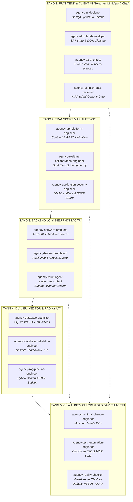

# KẾ HOẠCH HỘI ĐỒNG TÁC TỬ TOÀN DIỆN (FULL-STACK AGENCY COUNCIL PLAN)
# Preview — Audit — Fix — Upgrade MuLon Từ Frontend Đến Backend (v1.7.47+)

> **Cơ chế thực thi**: Phối hợp đa tác tử toàn diện (Full-Stack Swarm) gồm 15 AI Specialists từ The Agency (`~/.gemini/config/skills/agency-*`).  
> **Phạm vi bao phủ**: **Từ Frontend** (Telegram Mini App SPA 353KB, CSS Design System, Webview Mobile) **đến Backend** (Aiohttp API, Agent Orchestration, SQLite WAL/vec0, MCP Connectors, FastEmbed RAG).  
> **Chủ trì kỹ thuật**: Antigravity (Mac Builder)  
> **Thẩm định & Kiểm chứng độc lập**: Muse (VM Reviewer)  
> **Cơ quan phê duyệt tối cao**: Chủ dự án (`mmmnhat`)  
> **Nguyên tắc nền tảng**: Tuân thủ triệt để `AGENTS.md` (Zero Hardcode, Telegram-only, Proxy-only, Degrade không sập, 60/30/10 Mini App).

---

## 1. BẢN ĐỒ KIẾN TRÚC FULL-STACK (FRONTEND ĐẾN BACKEND)



---

## 2. KẾ HOẠCH HÀNH ĐỘNG CHI TIẾT TỪ FRONTEND ĐẾN BACKEND

### 📱 TẦNG 1: FRONTEND & CLIENT UI (Mini App SPA & Telegram Chat Surface)
*Chủ trì: `agency-frontend-developer`, `agency-ui-designer`, `agency-ux-architect`, `agency-ui-finish-gate-reviewer`*

* **Khảo sát hiện trạng (`mulon/webapp/index.html` - 353,925 bytes, SPA duy nhất)**:
  * Toàn bộ mã HTML, nhúng CSS token và hàng nghìn dòng JavaScript client (`renderAll`, `renderTasks`, `renderGoals`, `renderCLIProxy`) nằm chung trong một file `index.html`.
  * Có hơn 360 thuộc tính `style=""` inline rải rác; nhiều event listeners gắn động chưa có cơ chế dọn dẹp khi chuyển màn (`showSub`), tiềm ẩn rò rỉ bộ nhớ (memory leaks) trên WebView di động.
* **Hành động cụ thể (Tasks Frontend)**:
  - [ ] **Task FE-1 (Client JS Modularization)**: Phân tách logic client JavaScript thành các module chức năng rõ ràng (State Store, API Client, View Renderers), loại bỏ mã lặp và DOM manipulation trực tiếp thiếu kiểm soát.
  - [ ] **Task FE-2 (CSS Token & Inline Style Pruning)**: Dọn sạch 360 thuộc tính `style=""` inline, đưa về các class tiện ích chuẩn hoá dựa trên hệ thống Design Token tại `DESIGN.md` (`--paper`, `--surface`, `--ink`, `--lav`, `--accent`).
  - [ ] **Task FE-3 (Kỷ luật 60/30/10 & Finish Gate)**: Rà soát 100% các màn hình (`#screen-models`, `#screen-tasks`, `#screen-vault`, `#screen-feed`), triệt tiêu hoàn toàn màu trạng thái xanh/vàng/đỏ trong danh sách, chỉ giữ đúng 1 màu nhấn `--accent` (Tím Mulon `#7C3AED` theo đúng token code thật).
  - [ ] **Task FE-4 (Thumb Zone & Haptic Feedback)**: Tối ưu hoá vùng ngón cái cho thiết bị di động màn hình dài; tích hợp `Telegram.WebApp.HapticFeedback.impactOccurred` / `notificationOccurred` cho các thao tác phê duyệt, lưu cài đặt và chuyển tab.
  - [ ] **Task FE-5 (Render Thật & W3C Semantic Audit)**: Dùng Chromium headless chụp ảnh render thật ở cả 2 chế độ Telegram Light và Dark mode; chạy Nu HTML Checker chứng minh 0 lỗi semantic.

---

### 🌐 TẦNG 2: TRANSPORT & API GATEWAY
*Chủ trì: `agency-api-platform-engineer`, `agency-realtime-collaboration-engineer`, `agency-application-security-engineer`*

* **Khảo sát hiện trạng (`mulon/webapp_server.py` - 4,654 dòng)**:
  * Server aiohttp xử lý toàn bộ REST endpoint (`/api/state`, `/api/tasks`, `/api/goals`, `/api/approvals`, `/api/model`, `/api/vault`) và phục vụ static files.
  * Việc xác thực phụ thuộc vào HMAC `initData` gửi từ Telegram WebApp. Cần đảm bảo chống replay attack, xử lý lệch múi giờ và đồng bộ hai chiều mượt mà giữa Telegram chat và Mini App.
* **Hành động cụ thể (Tasks API & Gateway)**:
  - [ ] **Task API-1 (Contract Standardization)**: Chuẩn hoá schema dữ liệu trả về của toàn bộ `/api/*` theo định dạng nhất quán, có status code HTTP chuẩn mực và mã lỗi chi tiết (RFC 7807 Problem Details).
  - [ ] **Task API-2 (Đồng bộ 2 chiều Idempotent)**: Đảm bảo cơ chế đồng bộ thẻ phê duyệt giữa Chat Telegram và tab Phê duyệt Mini App hoàn toàn idempotent; khi user bấm duyệt ở chat thì giao diện WebApp cập nhật ngay lập tức mà không gây double-action.
  - [ ] **Task API-3 (HMAC & SSRF Hardening)**: Tăng cường xác thực HMAC `initData` với cửa sổ time drift hợp lệ; rà soát hàm `assert_url_public` chặn đứng 100% các dải IP private/link-local và DNS-rebinding TOCTOU khi gọi webhook/API ngoài.

---

### ⚙️ TẦNG 3: BACKEND LÕI & ĐIỀU PHỐI TÁC TỬ
*Chủ trì: `agency-backend-architect`, `agency-software-architect`, `agency-multi-agent-systems-architect`*

* **Khảo sát hiện trạng (`mulon/telegram_bot.py` - 5,086 dòng, `mulon/agent.py` - 1,188 dòng, `mulon/subagents.py` - 316 dòng)**:
  * `telegram_bot.py` quá lớn do chứa cả logic bắt sự kiện Telegram (handlers), gom tin (`MessageBatcher`), định dạng HTML streaming, xử lý tin thoại STT và điều hướng nghiệp vụ.
  * `mulon/agent.py` vận hành vòng lặp Plan-Act-Verify. Cần đảm bảo khả năng ngắt (cancellation) dứt điểm và phân bổ sub-agent song song không bị xung đột.
* **Hành động cụ thể (Tasks Backend Core)**:
  - [ ] **Task CORE-1 (ADR-001 Decoupling)**: Soạn Architecture Decision Record và tái cấu trúc nội bộ `telegram_bot.py`: tách riêng tầng Ingress (aiogram event dispatch), tầng Presentation/Streaming (`telegram_delivery.py`), và tầng Business Service.
  - [ ] **Task CORE-2 (Resilience & Circuit Breaker)**: Nâng cấp `mulon/gateway.py`: cài đặt circuit breaker chống cascading failure khi proxy model local `127.0.0.1:8317` bị chậm hoặc nghẽn; cơ chế fallback tất định về cheap model.
  - [ ] **Task CORE-3 (Subagent Swarm Orchestration)**: Nâng cấp `SubagentRunner`: hoàn thiện cơ chế cách ly token budget cho từng tác tử con, semaphore pool 4 workers, tự động nén kết quả thành digest gạch đầu dòng trước khi trả về cho Agent chính.

---

### 💾 TẦNG 4: DỮ LIỆU, VECTOR & RAG KÝ ỨC
*Chủ trì: `agency-database-optimizer`, `agency-database-reliability-engineer`, `agency-rag-pipeline-engineer`*

* **Khảo sát hiện trạng (`mulon/memory.py` - 2,617 dòng, SQLite WAL + FTS5 + vec0)**:
  * SQLite WAL lưu trữ hỗn hợp: tin nhắn chat, FTS5 toàn văn, bảng vector `vec0`, b-temporal facts, tasks, schedules, trajectories và feed.
  * Teardown test thường bị treo nhẹ do aiosqlite worker threads chưa đóng triệt để. Cần tối ưu hybrid search và quản trị vòng đời dữ liệu tạm.
* **Hành động cụ thể (Tasks Data & Memory)**:
  - [ ] **Task DATA-1 (Hybrid Search <20ms)**: Tối ưu hoá truy vấn kết hợp Vector Cosine Similarity (70%) và FTS5 BM25 (30%), đạt latency dưới 20ms ngay cả khi bảng facts vượt quá 50,000 bản ghi.
  - [ ] **Task DATA-2 (aiosqlite Connection Lifecycle)**: Xử lý triệt để việc giải phóng worker threads khi đóng ứng dụng/teardown test, triệt tiêu hoàn toàn cảnh báo tài nguyên và timeout pytest.
  - [ ] **Task DATA-3 (FastEmbed Cache & Zero-Cold-Start)**: Tối ưu hóa chu trình tải trọng số ONNX local (`bge-m3` / `multilingual-e5-large`), đảm bảo bot khởi động ngay lập tức không bị nghẽn lượt chat đầu.
  - [ ] **Task DATA-4 (Storage Cleanup & TTL)**: Thiết lập job nền định kỳ dọn dẹp file tạm và kết quả công cụ cũ trong `data/artifacts/tool-results/`.

---

### 🛡️ TẦNG 5: CỬA ẢI KIỂM CHỨNG & BẢO ĐẢM THỰC THI (REALITY GATE)
*Chủ trì: `agency-minimal-change-engineer`, `agency-test-automation-engineer`, `agency-reality-checker`*

* **Triết lý Reality Checker: MẶC ĐỊNH LÀ "NEEDS WORK"**:
  * Bất kỳ tính năng hay bản vá nào cũng bị coi là chưa hoàn thành nếu thiếu:
    1. Screenshot render thật từ trình duyệt Chromium trên chính mã nguồn đã build.
    2. Log curl tương tác thực tế hoặc tin nhắn đối soát từ Telegram thật.
    3. Bộ test hồi quy bổ sung và full suite `pytest tests/ -q` đạt 100% xanh.
* **Hành động cụ thể (Tasks Gate)**:
  - [ ] **Task GATE-1 (Minimal Diff Discipline)**: Mọi sửa đổi backend hay frontend đều phải có diff tối thiểu, từ chối trừu tượng hoá sớm (YAGNI), ưu tiên thư viện chuẩn.
  - [ ] **Task GATE-2 (E2E Test Coverage)**: Bổ sung các bài kiểm thử E2E bằng Playwright/Chromium cho toàn bộ các luồng: Đăng nhập WebApp -> Xem việc -> Phê duyệt -> Cấu hình Model.
  - [ ] **Task GATE-3 (Bằng chứng trước khi DONE)**: Xuất file artifact bằng chứng trước khi đổi trạng thái nhiệm vụ sang `DONE` để Muse nghiệm thu.

---

## 3. LỘ TRÌNH TRIỂN KHAI 4 CHẶNG ĐỒNG BỘ

```
Chặng 1: PREVIEW (Toàn diện Frontend + Backend)
  ├── Frontend: Quét DOM index.html, kiểm tra 360 inline styles, đo đạc layout
  └── Backend: Lập ma trận phụ thuộc 60 modules, rà soát SQLite WAL & aiosqlite threads
Chặng 2: AUDIT (Kiểm toán chuyên sâu 5 góc)
  ├── Audit 1: Bảo mật (Denylist, HMAC initData, SSRF)
  ├── Audit 2: Hiệu năng dữ liệu (SQLite WAL, vec0, Hybrid RAG 200k)
  ├── Audit 3: Giao diện (W3C Nu HTML, 60/30/10, WCAG 2.1 AA)
  └── Audit 4: Kiến trúc lõi (Coupling telegram_bot.py & webapp_server.py)
Chặng 3: FIX (Khắc phục theo Minimal Diff)
  ├── Sửa triệt để các tồn đọng phát hiện từ Audit
  └── Bổ sung unit/regression tests (100% green full suite)
Chặng 4: UPGRADE (Nâng tầm trải nghiệm Full-Stack)
  ├── Frontend: SPA module hoá, Thumb Zone, Telegram Haptics, Tím Mulon mượt mà
  └── Backend: Subagent swarm tối ưu, hybrid search <20ms, zero-cold-start
```

---

## 4. QUY TRÌNH DUYỆT & PHỐI HỢP CÙNG MUSE

1. **Trình duyệt Plan**: Bản kế hoạch Full-Stack từ Frontend đến Backend này được gắn mã nhiệm vụ **`[T-39]`** trong `AGENT_TASKS.md` và push lên `origin/main`.
2. **Reviewer phê duyệt**: Muse autowatch kéo về, đối chiếu với kiến trúc hệ thống và đưa ra ý kiến duyệt/phản biện.
3. **Thực thi có kiểm chứng**: Antigravity thực hiện từng task, tuân thủ kỷ luật của `agency-minimal-change-engineer`, qua ải của `agency-reality-checker` trước khi báo cáo cho Muse nghiệm thu `VERIFIED`.

---
*Ký tên trình duyệt kế hoạch:*
* **Antigravity (Mac Builder — Full-Stack Lead)** — *Đã ký*
* **Muse (VM Reviewer)** — *Chờ thẩm định*
* **Chủ dự án (mmmnhat)** — *Quyết định cuối cùng*
